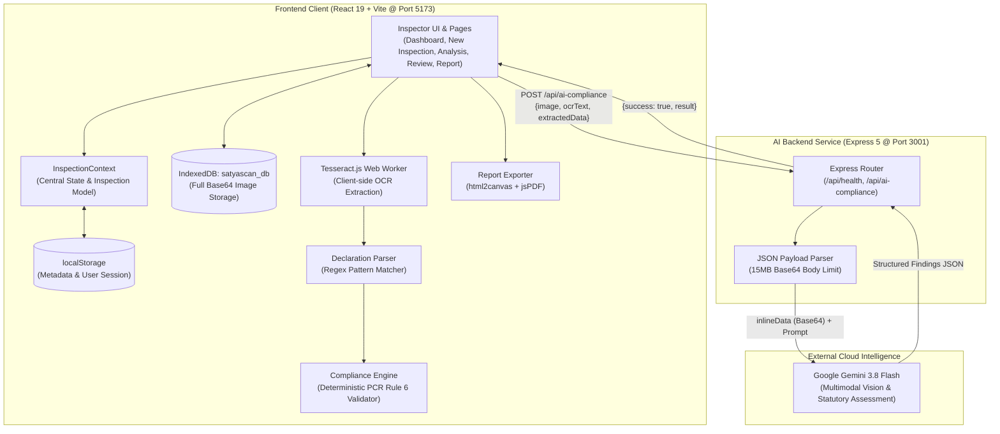
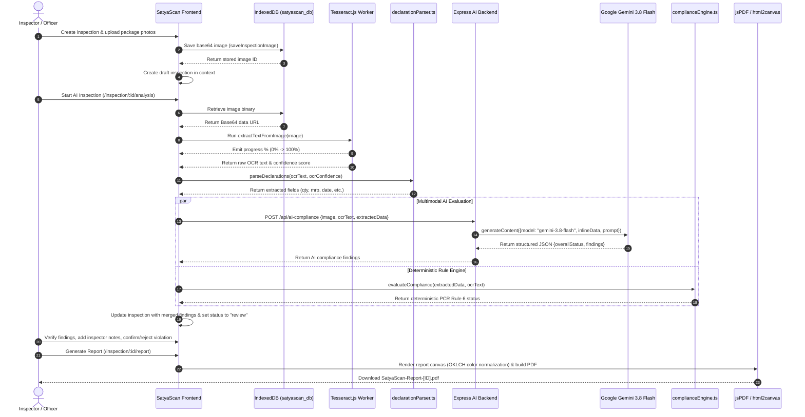

# SatyaScan

> **Smart. Connected. Citizen-first.**  
> *AI-assisted Legal Metrology compliance inspection platform for packaged commodities.*

[](https://react.dev/)
[](https://www.typescriptlang.org/)
[](https://vitejs.dev/)
[](https://tailwindcss.com/)
[](https://expressjs.com/)
[](https://ai.google.dev/)
[](https://tesseract.projectnaptha.com/)
[](https://oxc.rs/)
[](LICENSE)

---

## Table of Contents

- [1. Overview](#1-overview)
  - [Problem Statement](#problem-statement)
  - [Solution](#solution)
  - [Key Highlights](#key-highlights)
- [2. Features](#2-features)
- [3. Demo & Screenshots](#3-demo--screenshots)
- [4. Tech Stack](#4-tech-stack)
- [5. System Architecture](#5-system-architecture)
- [6. Request & Data Flow](#6-request--data-flow)
- [7. Project Structure](#7-project-structure)
- [8. API Reference](#8-api-reference)
- [9. Getting Started](#9-getting-started)
  - [Prerequisites](#prerequisites)
  - [Installation](#installation)
  - [Environment Variables](#environment-variables)
  - [Running the Application](#running-the-application)
  - [Demo Credentials](#demo-credentials)
- [10. Available Scripts](#10-available-scripts)
- [11. Configuration & Linting](#11-configuration--linting)
- [12. Deployment](#12-deployment)
- [13. Security & Limitations](#13-security--limitations)
- [14. Roadmap & Future Improvements](#14-roadmap--future-improvements)
- [15. Contributing](#15-contributing)
- [16. License & Contact](#16-license--contact)

---

## 1. Overview

### Problem Statement
In retail and distribution supply chains, pre-packaged goods must comply with statutory packaging standards under the **Legal Metrology (Packaged Commodities) Rules, 2011 (PCR Rule 6)**. Regulators and field enforcement officers must verify that mandatory declarations—including net quantity, Maximum Retail Price (MRP), date of manufacture/packing, manufacturer identity, and consumer care channels—are clearly printed, accurate, and non-deceptive. 

Manual inspections are time-consuming, paper-heavy, error-prone, and challenging to scale across thousands of SKUs in physical markets. Furthermore, transcription errors and lack of standardized visual audit trails create friction between regulatory bodies and businesses.

### Solution
**SatyaScan** is a modern, AI-assisted Legal Metrology enforcement platform designed to accelerate, standardize, and record packaged-commodity inspections. Field officers capture or upload packaging photos, and SatyaScan runs a multi-stage audit pipeline:
1. **Client-side OCR** extracts raw textual evidence with real-time recognition progress.
2. **Deterministic Declaration Parsing** isolates mandatory packaging fields via pattern heuristics.
3. **Multimodal AI Vision Intelligence** powered by Google Gemini 3.8 Flash audits image evidence against OCR text to detect missing, non-compliant, or ambiguous labels.
4. **Deterministic Rule Validation** checks statutory formatting, standard units, currency presentation, and dates.
5. **Human-in-the-Loop Verification** allows authorized inspectors to confirm violations, override results, add case justifications, or order retakes.
6. **Official Inspection Certification** exports multi-page PDF audit reports and print-ready records.

### Key Highlights
- **Human-in-the-Loop Governance**: AI assists and surfaces evidence, but the human inspector retains full authority to confirm or reject findings.
- **Dual Verification Engine**: Combines deterministic statutory pattern rules with Google Gemini 3.8 Flash multimodal reasoning.
- **Client-Side Image Persistence**: Employs browser IndexedDB to safely store high-resolution inspection photos without triggering browser `localStorage` quota crashes.
- **Statutory Alignment**: Evaluates core declarations against Legal Metrology PCR Rule 6 specifications.
- **Export-Ready**: One-click generation of A4 PDF inspection certificates with multi-page support and OKLCH color normalization.

---

## 2. Features

### Authentication & Role-Based Access
- Role-based login supporting **Officer** and **Admin** personas.
- Client session persistence using browser storage (`satyascan_session`).
- Protected application shell with redirection guards.

### Inspection Intake & Asset Storage
- Case initiation capturing **Product Name**, **Manufacturer**, **Inspection Location**, and **Inspector Name**.
- Multi-image packaging upload supporting PNG, JPG, and JPEG.
- Categorization of photo views (`front`, `back`, `side`, `other`).
- Scalable client-side storage powered by **IndexedDB** (`satyascan_db`), isolating large binary base64 images from JSON metadata stored in `localStorage`.

### Real-Time Text Recognition (OCR)
- In-browser optical character recognition using **Tesseract.js** (`eng` model).
- Real-time recognition percentage indicator and confidence scoring.
- Live OCR raw transcript stream with clean layout preservation.

### Structured Declaration Parser
- Deterministic extraction heuristics extracting 7 mandatory package declarations:
  - **Net Quantity** (units: kg, g, mg, ml, l, litre, liter)
  - **Maximum Retail Price (MRP)** (numeric amount with or without currency symbol)
  - **Manufacturing / Packing Date** (DD/MM/YYYY, MM/YYYY, etc.)
  - **Expiry / Best-Before Date** (explicit date or duration such as "36 months")
  - **Batch / Lot Number** (alphanumeric code validation with false-positive filtering)
  - **Consumer Care Details** (+91 10-digit telephone numbers and email addresses)
  - **Manufacturer / Packer / Importer Name** (pattern recognition filtering out field labels)

### Dual Compliance Engine
- **Deterministic Rule Checker (`complianceEngine.ts`)**: Evaluates parsed fields against standard metric units, numeric price validity, currency presence, and contact information syntax.
- **Multimodal AI Analysis (`aiComplianceService.ts` & `server/index.js`)**: Passes base64 image data and OCR transcripts to **Gemini 3.8 Flash** with strict JSON output schemas, identifying package discrepancies, visual tampering, and omitted declarations.

### Inspector Review & Verification
- Side-by-side evidence inspection: high-resolution image viewer with interactive zoom (50%–150%) and bounding evidence regions.
- Automated findings checklist categorized by status: `PASS`, `FAIL`, or `REVIEW`.
- Inspector actions:
  - **Confirm Violation**: Officially flags inspection as non-compliant.
  - **Reject Finding**: Dismisses AI warning and marks record as completed.
  - **Request Retake**: Re-queues inspection for new image capture.
  - **Flag for Manual Audit**: Keeps case in review for secondary investigation.
- Inspector verification notes and audit rationale attachment.

### Reporting & Documentation
- Official Legal Metrology Inspection Report generation.
- Interactive print dialog integration (`window.print()`).
- High-fidelity PDF export via `html2canvas` and `jsPDF`, with automated OKLCH CSS color normalization to prevent canvas rendering errors.
- Visual status badges, severity tags (`LOW`, `MEDIUM`, `HIGH`, `CRITICAL`), and recommended enforcement actions.

### History & Auditing
- Historical inspection registry with multi-parameter search (case ID, product name, manufacturer, location).
- Status filtering (`ALL`, `COMPLIANT`, `NON-COMPLIANT`, `REVIEW_PENDING`, `review`, `analyzing`).
- Aggregated 30-day dashboard KPIs, compliance trends, and violation distribution charts.

---

## 3. Demo & Screenshots

> *Below are placeholders for interface previews. Replace these with actual visual assets before release.*

### Enforcement Dashboard
<!-- TODO: Add screenshot of /dashboard showing KPI cards, compliance trends, and pending reviews -->
```
+---------------------------------------------------------------------------------+
| SatyaScan Enforcement Overview                                [ + New Inspection ]|
+-------------------+-------------------+-------------------+---------------------+
| Total Inspections | Compliant         | Non-Compliant     | Under Review        |
| 1,492             | 1,105 (74%)       | 284               | 103                 |
+-------------------+-------------------+-------------------+---------------------+
| [Pending Inspector Reviews Table]         | [Compliance Trend & AI Insight Card] |
+---------------------------------------------------------------------------------+
```

### New Inspection & Image Intake
<!-- TODO: Add screenshot of /inspection/new with package upload and metadata inputs -->
```
+---------------------------------------------------------------------------------+
| New Inspection                                                                   |
| [ Product Name: Basmati Rice 5kg ]   |  +-------------------------------------+  |
| [ Manufacturer: AgriFoods Ltd.   ]   |  |  Upload Packaging Photos (Front/Back)|  |
| [ Location:     Pune             ]   |  |  [ Drag and Drop / Browse Files ]   |  |
| [ Inspector:    Officer Sharma   ]   |  +-------------------------------------+  |
+---------------------------------------------------------------------------------+
```

### Evidence Viewer & Live OCR Analysis
<!-- TODO: Add screenshot of /inspection/:id/analysis with OCR text and extracted declarations -->
```
+---------------------------------------------------------------------------------+
| Extracted Declarations & Evidence Viewer                         Case: #INSP-2938|
+------------------------------------------+--------------------------------------+
| [ Image Viewer with Zoom & Bounding Box] | Live OCR Extraction (Progress: 100%) |
|                                          | Net Quantity: 5 kg           [PASS]  |
|                                          | MRP:          ₹249           [PASS]  |
|                                          | Mfg Date:     10/2025        [PASS]  |
|                                          | Consumer Care: care@brand.in [PASS]  |
+---------------------------------------------------------------------------------+
```

### Inspector Verification & Legal Metrology Report
<!-- TODO: Add screenshot of /inspection/:id/report showing PDF export view -->
```
+---------------------------------------------------------------------------------+
| Official Inspection Report: INSP-2938                     [ Print ] [ Export PDF]|
+---------------------------------------------------------------------------------+
| SatyaScan | Overall Result: COMPLIANT | Compliance Score: 100%                   |
| Product: Basmati Rice 5kg | Manufacturer: AgriFoods Ltd. | Inspector: AO         |
| [ PCR Rule 6 Mandatory Checklist: All 4 Statutory Rules Passed ]                 |
+---------------------------------------------------------------------------------+
```

---

## 4. Tech Stack

| Category | Technology | Version | Purpose |
|---|---|---|---|
| **Frontend Framework** | [React](https://react.dev/) | `^19.2.8` | Declarative UI and component-driven views |
| **Language** | [TypeScript](https://www.typescriptlang.org/) | `~6.0.2` | Static type safety, strict interface models |
| **Build Tool & Bundler** | [Vite](https://vitejs.dev/) | `^8.2.2` | Fast HMR dev server and optimized production build |
| **Styling** | [Tailwind CSS](https://tailwindcss.com/) | `^4.3.3` | Utility-first responsive styling via `@tailwindcss/vite` |
| **Routing** | [React Router](https://reactrouter.com/) | `^7.18.3` | Client-side routing and protected navigation |
| **Icons** | [Lucide React](https://lucide.dev/) | `^1.41.0` | Accessible SVG interface iconography |
| **Client OCR** | [Tesseract.js](https://tesseract.projectnaptha.com/) | `^7.0.0` | In-browser optical character recognition worker |
| **Client Storage** | IndexedDB API | Browser Native | High-capacity asynchronous binary image cache (`satyascan_db`) |
| **Backend Server** | [Express](https://expressjs.com/) | `^5.2.1` | Lightweight REST API server for AI compliance processing |
| **CORS Middleware** | [cors](https://www.npmjs.com/package/cors) | `^2.8.6` | Cross-origin resource sharing enablement |
| **Environment Config** | [dotenv](https://www.npmjs.com/package/dotenv) | `^17.4.2` | Environment variable management for Node backend |
| **Multimodal AI** | [@google/genai](https://www.npmjs.com/package/@google/genai) | `^2.21.0` | Google GenAI SDK interfacing with `gemini-3.8-flash` |
| **Alternative AI SDK** | [OpenAI](https://www.npmjs.com/package/openai) | `^7.10.0` | Installed in dependencies (reserved for multi-model fallback) |
| **Document Export** | [html2canvas](https://html2canvas.hertzen.com/) | `^1.4.1` | DOM-to-canvas rasterizer with custom OKLCH color handler |
| **PDF Generation** | [jsPDF](https://github.com/parallax/jsPDF) | `^4.2.1` | Multi-page A4 document composition and download |
| **Linting** | [Oxlint](https://oxc.rs/) | `^1.79.0` | High-performance Rust-based JavaScript/TypeScript linter |

---

## 5. System Architecture



### Architecture Walkthrough
1. **Separation of Concerns**: The frontend operates as a self-contained progressive web tool. It performs OCR, deterministic parsing, and rule checks on-device.
2. **Storage Decoupling**: High-resolution packaging photos are stored directly in browser **IndexedDB** (`satyascan_db`), while lightweight structured inspection metadata is stored in **localStorage** (`satyascan_inspections`), guaranteeing immunity against browser storage quota crashes.
3. **Multimodal Co-Processing**: While client-side OCR and regex extraction identify explicit textual tokens, the server-side **Google Gemini 3.8 Flash** engine visually cross-checks the image against OCR claims to detect inconsistencies, poorly legible fonts, or missing mandatory units.
4. **Backend Security Boundary**: The client never directly calls Google GenAI. All AI traffic is mediated through the Express backend, keeping `GEMINI_API_KEY` secret.

---

## 6. Request & Data Flow

The following sequence diagram illustrates the lifecycle of a packaging inspection from initial photo capture to certified PDF export:



---

## 7. Project Structure

```
SatyaScan/
├── .gitignore                      # Git ignore rules (node_modules, logs, .env)
├── .oxlintrc.json                  # Oxlint configuration (React & TypeScript rules)
├── index.html                      # Single page application HTML root
├── package.json                    # Workspace dependencies and lifecycle scripts
├── package-lock.json               # Locked dependency tree
├── tsconfig.json                   # Root TypeScript project reference configuration
├── tsconfig.app.json               # Application TypeScript compiler settings
├── tsconfig.node.json              # Node and Vite build tools TypeScript configuration
├── vite.config.ts                  # Vite configuration with React & Tailwind plugins
│
├── public/                         # Static public assets served at root
│   ├── favicon.svg                 # Application favicon
│   └── icons.svg                   # SVG symbol sprite definitions
│
├── server/                         # Express AI backend service
│   └── index.js                    # Express app, Gemini 3.8 Flash integration, compliance endpoints
│
└── src/                            # React client source code
    ├── main.tsx                    # React application entry point with Context Provider
    ├── App.tsx                     # Top-level routes, protected routing, and app shell wrapper
    ├── App.css                     # Component animations and presentation styles
    ├── index.css                   # Global styles and Tailwind CSS v4 entrypoint
    │
    ├── assets/                     # Packaged client images and graphics
    │   ├── hero.png                # Marketing/landing presentation asset
    │   ├── react.svg               # React template asset
    │   ├── SatyaScan logo.jpeg     # Official SatyaScan crest and logo
    │   └── vite.svg                # Vite template asset
    │
    ├── components/                 # Shared presentation components
    │   ├── layout/
    │   │   ├── AppShell.tsx        # Standard page frame with fixed Sidebar & Topbar
    │   │   ├── Sidebar.tsx         # Sidebar navigation links, branding, and export triggers
    │   │   └── Topbar.tsx          # Header search bar, notification trigger, and case CTA
    │   └── ui/
    │       └── PagePlaceholder.tsx # Reusable placeholder frame for modules under development
    │
    ├── context/                    # Application state management
    │   └── InspectionContext.tsx   # Inspections state, persistent localStorage, CRUD helpers
    │
    ├── data/                       # Mock and benchmark datasets
    │   └── dashboardData.ts        # Historical metrics, violation distributions, and action logs
    │
    ├── pages/                      # Application route views
    │   ├── Dashboard.tsx           # Enforcement overview, KPIs, trends, and review queue
    │   ├── Login.tsx               # Officer/Admin sign-in with built-in demo credentials
    │   ├── NewInspection.tsx       # Case creation and multi-angle packaging image upload
    │   ├── InspectionAnalysis.tsx  # Live OCR progress, evidence viewer, zoom, declaration parsing
    │   ├── ComplianceCheck.tsx     # Rule-engine checklist view and status evaluations
    │   ├── ReviewVerify.tsx        # Human-in-the-loop audit, inspector notes, override buttons
    │   ├── Report.tsx              # Formal Legal Metrology report, print, and PDF export
    │   └── History.tsx             # Paginated/searchable inspection registry with status filters
    │
    ├── services/                   # Business logic, ML, storage, and API services
    │   ├── aiComplianceService.ts  # Client client wrapper calling backend /api/ai-compliance
    │   ├── complianceEngine.ts     # Deterministic statutory rule engine (PCR Rule 6)
    │   ├── declarationParser.ts    # Regex parsing logic for 7 mandatory packaging declarations
    │   ├── imageStorage.ts         # IndexedDB client storage for high-resolution images
    │   └── ocrService.ts           # Tesseract.js worker management and progress callbacks
    │
    └── utils/                      # Helper utilities and shared constants
        └── constants.ts            # Brand strings, application taglines, and fallback demo IDs
```

---

## 8. API Reference

The backend Express application (`server/index.js`) exposes the following REST endpoints:

### 1. Health Check
Checks backend service availability.

- **Method**: `GET`
- **Route**: `/api/health`
- **Headers**: None
- **Request Body**: None
- **Response**: `200 OK`
  ```json
  {
    "success": true,
    "message": "SatyaScan AI backend is running"
  }
  ```

---

### 2. AI Connection Test
Tests live connectivity between the Express server and Google GenAI (`gemini-3.8-flash`).

- **Method**: `GET`
- **Route**: `/api/ai-test`
- **Headers**: None
- **Request Body**: None
- **Response**: `200 OK`
  ```json
  {
    "success": true,
    "message": "SatyaScan AI connection successful"
  }
  ```
- **Error Response**: `500 Internal Server Error`
  ```json
  {
    "success": false,
    "error": "Gemini API request failed"
  }
  ```

---

### 3. AI Compliance Analysis
Analyzes a package image alongside OCR text and extracted declarations to evaluate Legal Metrology compliance.

- **Method**: `POST`
- **Route**: `/api/ai-compliance`
- **Headers**: `Content-Type: application/json`
- **Payload Limit**: `15mb`
- **Request Body**:
  | Field | Type | Required | Description |
  |---|---|---|---|
  | `image` | `string` | **Yes** | Image as a base64 Data URL (`data:image/jpeg;base64,...`) |
  | `ocrText` | `string` | No | Raw text extracted by client OCR |
  | `extractedData` | `object` | No | Key-value pairs extracted by regex parser |

  *Example Request Body:*
  ```json
  {
    "image": "data:image/jpeg;base64,/9j/4AAQSkZJRg...",
    "ocrText": "PREMIUM BASMATI RICE\nNET WEIGHT: 5 kg\nMRP: Rs. 249.00\nMFG DATE: 10/2025\nBATCH NO: B8849\nCUSTOMER CARE: 1800-200-1234",
    "extractedData": {
      "netQuantity": "5 kg",
      "mrp": "249.00",
      "manufacturingDate": "10/2025",
      "batchNumber": "B8849",
      "consumerCare": "1800-200-1234"
    }
  }
  ```

- **Response**: `200 OK`
  ```json
  {
    "success": true,
    "result": {
      "overallStatus": "COMPLIANT",
      "summary": "Mandatory declarations are visibly present and conform to PCR Rule 6.",
      "confidence": 92,
      "findings": [
        {
          "field": "netQuantity",
          "detectedValue": "5 kg",
          "status": "PASS",
          "reason": "Standard SI unit declared with prominent numeric weight.",
          "ruleReference": "PCR Rule 6",
          "evidence": "Observed 'NET WEIGHT: 5 kg' on lower front panel.",
          "confidence": 95
        },
        {
          "field": "mrp",
          "detectedValue": "249.00",
          "status": "PASS",
          "reason": "Maximum retail price declared inclusive of all taxes.",
          "ruleReference": "PCR Rule 6",
          "evidence": "Observed 'MRP: Rs. 249.00' on back panel.",
          "confidence": 90
        }
      ]
    }
  }
  ```
- **Possible `overallStatus` values**:
  - `COMPLIANT`: All verified statutory declarations passed inspection.
  - `NON-COMPLIANT`: Clear regulatory violation detected (e.g. invalid MRP format, missing manufacturer).
  - `REVIEW_PENDING`: Image evidence is ambiguous or declarations require physical inspector verification.
- **Error Responses**:
  - `400 Bad Request`: Missing image, invalid non-data URL, or malformed base64 payload.
    ```json
    {
      "success": false,
      "error": "Image must be provided as a data URL"
    }
    ```
  - `500 Internal Server Error`: Upstream Gemini model error or unparsable model response.
    ```json
    {
      "success": false,
      "error": "AI compliance analysis failed",
      "details": "API key not valid"
    }
    ```

---

## 9. Getting Started

### Prerequisites
- **Node.js**: `v18.0.0` or higher (Node.js 20+ LTS recommended)
- **npm**: `v9.0.0` or higher (or `pnpm` / `yarn`)
- **Google Gemini API Key**: Obtainable from [Google AI Studio](https://aistudio.google.com/)

### Installation

1. **Clone the repository:**
   ```bash
   git clone https://github.com/high-flyer007/SatyaScan.git
   cd SatyaScan
   ```

2. **Install project dependencies:**
   ```bash
   npm install
   ```

### Environment Variables
Configure the environment variables before launching the services. Create a `.env` file in the project root:

```bash
# In the repository root
touch .env
```

Add the following variables (all values read directly from codebase references):

| Variable | Target Service | Required | Default | Description |
|---|---|---|---|---|
| `GEMINI_API_KEY` | Backend (`server/index.js`) | **Yes** | *None* | Google GenAI API key for Gemini 3.8 Flash analysis |
| `PORT` | Backend (`server/index.js`) | No | `3001` | Local port for Express AI backend service |
| `VITE_AI_BACKEND_URL` | Frontend (`src/services/aiComplianceService.ts`) | No | `http://localhost:3001` | Origin URL of the SatyaScan AI Express backend |

*Example `.env` configuration:*
```env
# Backend Configuration
PORT=3001
GEMINI_API_KEY=AIzaSyYourSecretGeminiApiKeyHere

# Frontend Configuration (Used by Vite at build/runtime)
VITE_AI_BACKEND_URL=http://localhost:3001
```

### Running the Application

SatyaScan requires both the Express AI backend and the Vite frontend to be running.

#### Option A: Run in Two Terminals (Recommended)

1. **Terminal 1: Start the AI Backend Server**
   ```bash
   node server/index.js
   ```
   *Expected output:*
   ```
   SatyaScan AI server running on port 3001
   ```

2. **Terminal 2: Start the Vite Frontend Client**
   ```bash
   npm run dev
   ```
   *Expected output:*
   ```
   VITE v8.2.2  ready in 250 ms

   ➜  Local:   http://localhost:5173/
   ➜  Network: use --host to expose
   ```

Open your browser and navigate to `http://localhost:5173`.

#### Option B: Production Build and Preview

1. **Build the frontend bundle (runs TypeScript type-check and Vite build):**
   ```bash
   npm run build
   ```

2. **Preview the built production application:**
   ```bash
   npm run preview
   ```

### Demo Credentials
SatyaScan includes pre-configured credentials on the login screen (`/login`):

| Role | Username | Password | Intended Workflow |
|---|---|---|---|
| **Officer** | `officer` | `1234` | Field enforcement, case logging, verification & reporting |
| **Admin** | `admin` | `1234` | System configuration, cross-district review & supervisory audit |

---

## 10. Available Scripts

Defined in `package.json`:

| Command | Action | Execution Details |
|---|---|---|
| `npm run dev` | Starts local frontend development server | Runs `vite` with Hot Module Replacement (HMR) |
| `npm run build` | Builds production distribution | Runs `tsc -b` (composite typecheck) followed by `vite build` |
| `npm run lint` | Runs fast static linter | Executes `oxlint` against codebase rules |
| `npm run preview` | Runs local production preview | Runs `vite preview` to test compiled output in `/dist` |
| `node server/index.js` | Runs Express AI backend | Starts Node.js ES-module HTTP server on `PORT` (default: 3001) |

---

## 11. Configuration & Linting

### Vite & Tailwind CSS v4
The application uses Vite (`vite.config.ts`) configured with:
- `@vitejs/plugin-react`: Enables React 19 fast refresh using the Oxlint-compatible JSX runtime.
- `@tailwindcss/vite`: Official Vite integration plugin for Tailwind CSS v4, utilizing `@import "tailwindcss";` in `src/index.css` without requiring legacy `postcss.config.js` or `tailwind.config.js`.

### TypeScript Configuration
TypeScript (~6.0.2) is configured via composite project references:
- `tsconfig.json`: Root aggregator referencing `./tsconfig.app.json` and `./tsconfig.node.json`.
- `tsconfig.app.json`: Configures the browser runtime (`ES2023`, `DOM`, `moduleResolution: bundler`, `verbatimModuleSyntax: true`, and strict checks: `noUnusedLocals`, `noUnusedParameters`, `erasableSyntaxOnly`).
- `tsconfig.node.json`: Configures compiler rules for node-based tooling (`vite.config.ts`).

### Oxlint
SatyaScan uses [Oxlint](https://oxc.rs/) (`.oxlintrc.json`), an ultra-fast Rust-based linter. Configured plugins and rules:
```json
{
  "$schema": "./node_modules/oxlint/configuration_schema.json",
  "plugins": ["react", "typescript", "oxc"],
  "rules": {
    "react/rules-of-hooks": "error",
    "react/only-export-components": ["warn", { "allowConstantExport": true }]
  }
}
```

---

## 12. Deployment

### Frontend (Vercel / Netlify / Cloudflare Pages)
1. **Build Settings**:
   - **Framework Preset**: Vite
   - **Build Command**: `npm run build`
   - **Output Directory**: `dist`
   - **Install Command**: `npm install`
2. **Environment Variables**:
   - Set `VITE_AI_BACKEND_URL` to your production backend URL (e.g., `https://api.satyascan.gov.in` or `https://satyascan-backend.onrender.com`).
3. **Single-Page Application Routing**:
   Ensure route rewrites are configured to route all non-file traffic to `index.html`.

### Backend (Render / Railway / Fly.io / Docker / VPS)
1. **Environment Setup**:
   - Set `NODE_ENV=production`
   - Set `PORT=3001` (or host-assigned port)
   - Set `GEMINI_API_KEY` to your valid Google AI Studio key
2. **Execution**:
   - Run command: `node server/index.js`
3. **CORS Configuration**:
   - For strict production deployments, replace the default open `cors()` middleware in `server/index.js` with your production frontend domain:
     ```javascript
     app.use(cors({ origin: process.env.FRONTEND_URL || "https://satyascan.vercel.app" }));
     ```

---

## 13. Security & Limitations

### Security Considerations
- **Isolated Secret Storage**: The `GEMINI_API_KEY` is maintained exclusively on the server side (`server/index.js`). It is never passed to or bundled within client code.
- **Payload Restrictions**: The Express JSON parser enforces a strict `15mb` ceiling (`express.json({ limit: "15mb" })`) to prevent heap exhaustion attacks from massive image uploads.
- **Client Sanitization**: OCR output strings and regex inputs undergo whitespace and special character normalization (`declarationParser.ts`) to prevent format exploitation.

### Known Limitations
- **Prototype Status & Legal Disclaimer**: SatyaScan is an **AI-assisted decision-support prototype**. It does not constitute a final statutory decree, legal certification, or automated penalty order under the Legal Metrology Act, 2009. Final administrative and statutory decisions rest solely with authorized human inspectors.
- **Image Clarity Dependency**: Tesseract.js client OCR and Gemini visual analysis depend on adequate resolution, flat angle alignment, legible contrast, and packaging glare minimization. Poor lighting or wrinkled packaging may return `REVIEW_PENDING`.
- **Client Storage Ceiling**: While IndexedDB stores significantly more data than `localStorage`, browser quotas depend on available disk space. Storing hundreds of high-resolution uncompressed images locally may eventually trigger storage limits.
- **Language Coverage**: The current OCR worker model is initialized for English (`eng`). Multilingual packaging (e.g. Hindi, regional languages) is pending integration.
- **OpenAI Package**: The `openai` package is listed in `package.json` dependencies but is currently dormant; Google Gemini 3.8 Flash is the active multimodal engine.

---

## 14. Roadmap & Future Improvements

- [ ] **Multi-Model LLM Fallback**: Activate the installed `openai` dependency to provide dual-provider failover (OpenAI GPT-4o / Google Gemini).
- [ ] **Barcode & QR Code Auditing**: Integrate statutory QR/barcode decoding to cross-reference physical label text with digital regulatory records.
- [ ] **Cloud Asset Storage**: Migrate local IndexedDB image storage to S3-compatible cloud storage (e.g., AWS S3, Cloudflare R2) with signed URLs.
- [ ] **Multilingual Indian Language OCR**: Extend Tesseract.js language packs to support Hindi (`hin`), Marathi (`mar`), Tamil (`tam`), and Bengali (`ben`).
- [ ] **Implementation of Placeholder Modules**:
  - `<!-- TODO: Wire up live backend database for /products (Product Repository) -->`
  - `<!-- TODO: Wire up manufacturer database and compliance history for /manufacturers -->`
  - `<!-- TODO: Complete rule configuration builder in /rules -->`
  - `<!-- TODO: Add live analytical aggregation in /analytics -->`
  - `<!-- TODO: Add multi-user RBAC and officer provisioning in /users -->`
  - `<!-- TODO: Implement immutable audit trail logging in /audit-log -->`

---

## 15. Contributing

Contributions to SatyaScan are welcome. To contribute:

1. **Fork the repository** on GitHub.
2. **Create a feature branch:**
   ```bash
   git checkout -b feature/improved-pcr-rule-engine
   ```
3. **Commit your modifications:**
   ```bash
   git commit -m "feat: add volumetric liquid declaration validation under PCR Rule 6"
   ```
4. **Run code quality checks:**
   ```bash
   npm run lint
   npm run build
   ```
5. **Push to your branch:**
   ```bash
   git push origin feature/improved-pcr-rule-engine
   ```
6. **Open a Pull Request** describing your changes and testing steps.

---

## 16. License & Contact

### License
This project is open-source software licensed under the **MIT License**. See the `LICENSE` file for full terms.

### Author & Maintainer
- **Author**: `high-flyer007`
- **Email**: [m.alipathan2905@gmail.com](mailto:m.alipathan2905@gmail.com)
- **Repository**: [https://github.com/high-flyer007/SatyaScan](https://github.com/high-flyer007/SatyaScan)

---

<p align="center">
  <b>SatyaScan</b> — Empowering Legal Metrology Enforcement with Transparent AI.
</p>
